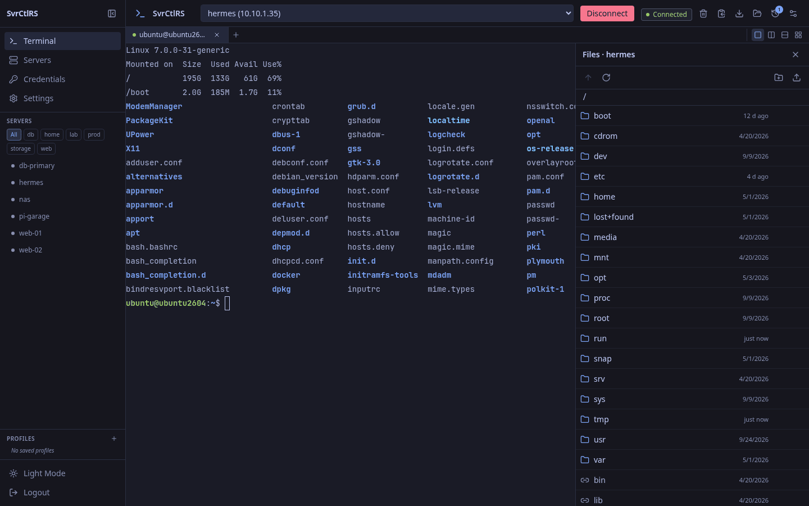
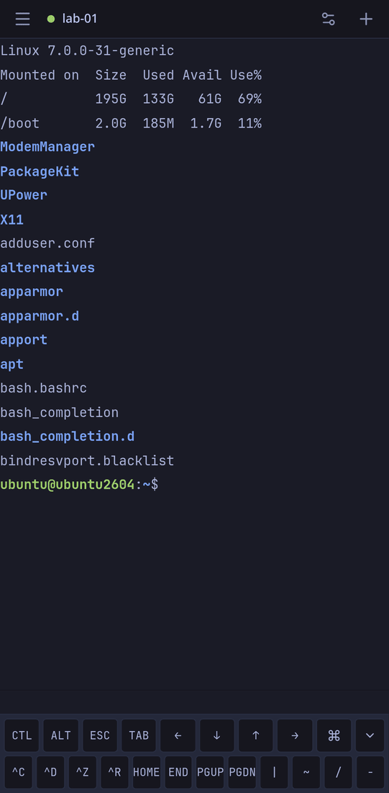
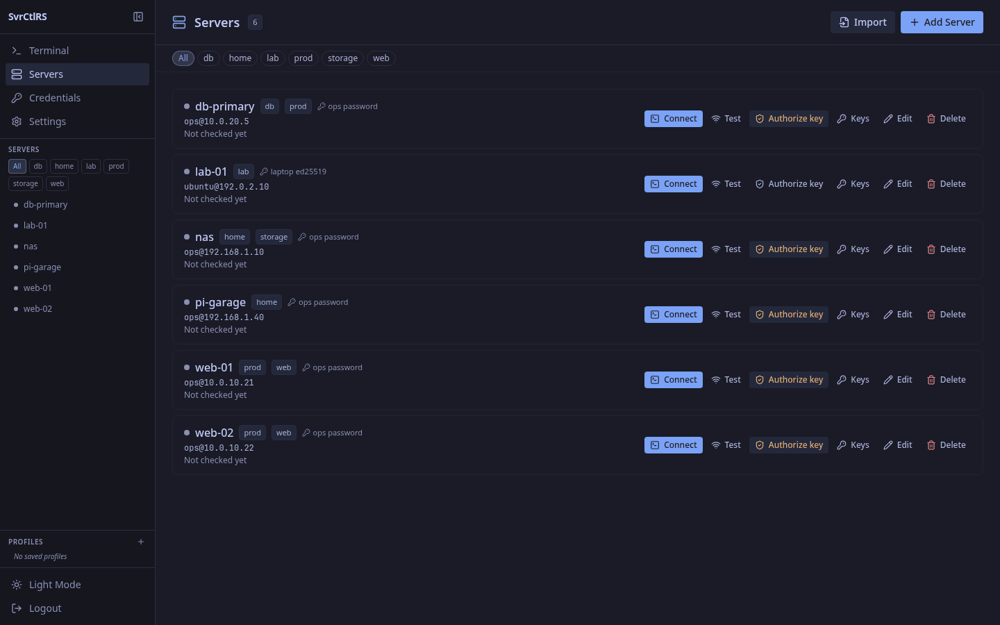
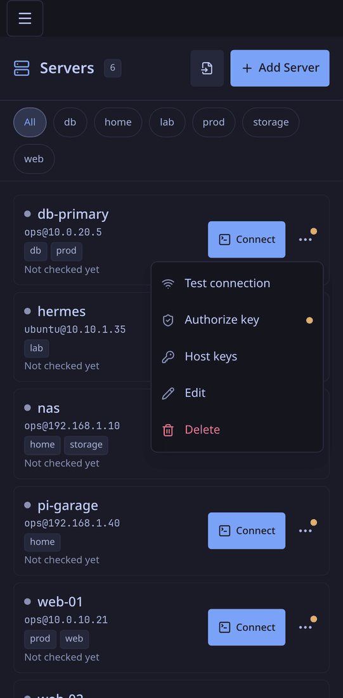

# SvrCtlRS

Self-hosted terminal and SSH management for your servers: interactive shells in the browser
and on your phone (an installable web app), shells that keep running when the phone sleeps,
encrypted credentials, multi-pane layouts and an SFTP file browser. One Rust binary, one SQLite
file.

**Version 4.0.0** · Rust (Axum) · SvelteKit 5 · xterm.js 6 · Tauri 2 · SQLite

> 3.x is a different product from the 1.x/2.x releases. Those were a plugin-based monitoring
> platform and were retired in March 2026; nothing from them survives in this repository.

## What it does

- **Interactive terminals** — full PTY sessions over WebSocket (russh on the server, xterm.js
  with WebGL rendering in the client). Tabs, four layouts (single, split horizontal, split
  vertical, quad), up to 10 sessions, output search, session restore across page navigation.
- **Servers and credentials** — server profiles (host, port, user, credential), password and
  SSH-key credentials encrypted at rest with AES-256-GCM; both kinds work for the shell.
- **Files** — browse a server over SFTP beside the terminal: view text and images, edit small
  files (a change made on the server meanwhile is never overwritten) or open them in the
  server's own `$EDITOR` in a new tab, download, upload (drag and drop on the desktop), new
  folder, rename, delete. Same connection rules as the shell, every write in the audit log.
- **Host-key verification** — the first connection shows the server's fingerprint for you to
  confirm; a changed key blocks the connection.
- **Jump hosts, tags, `ssh_config` import** — reach a server through another one, filter the
  lists by tag, and create servers from `~/.ssh/config` (`ProxyJump` becomes the jump host).
- **Terminal profiles** — save a layout plus which server opens in each pane; mark one as the
  default to auto-load at start.
- **Quick commands** — a per-user library of snippets, grouped by category, launched from the
  command palette (`Ctrl+K`).
- **Notifications** — [rstify](https://git.js-node.cc/jsprague/rstify)/Gotify/ntfy push for
  server health checks and command completion.
- **Agents** — named API tokens with access presets (full admin, servers & keys,
  read-only), approvals for the deletes that cannot be undone, an OpenAPI document, and
  `svrctl`, a CLI made for agents (JSON when piped, stable exit codes, hints in errors) with
  a skill file (`skills/svrctlrs/SKILL.md`) that Hermes, Claude Code and other agents load.
  `svrctl diagnose <server>` answers "why can't I reach it?" step by step, with a fix.
- **Clients** — the web UI served by the server, with a mobile layout (touch gestures, an
  extra-keys row, swipe between tabs) that works in a phone browser; and a Tauri desktop app
  for Linux (`.deb`, `.rpm`, AppImage, and a Nix flake: `nix run
  git+https://git.js-node.cc/jsprague/svrctlrs#desktop`) that signs in through your browser and
  leaves Ctrl+W to vim.

## Screenshots

| | |
|---|---|
|  |  |
|  |  |

## Quick start (Docker)

```bash
mkdir -p ~/docker-compose/svrctlrs && cd ~/docker-compose/svrctlrs
curl -fsSL https://git.js-node.cc/jsprague/svrctlrs/raw/branch/master/docker-compose.standalone.yml -o docker-compose.yml
curl -fsSL https://git.js-node.cc/jsprague/svrctlrs/raw/branch/master/.env.example -o .env
chmod 600 .env
# Edit .env: set ADMIN_PASSWORD and ENCRYPTION_KEY (openssl rand -hex 32)
docker compose up -d
```

That serves `http://127.0.0.1:8080` for a reverse proxy (TLS) on the same host; set
`SVRCTLRS_BIND=8080` to expose it on the LAN, with `SESSION_SECURE=false` on plain HTTP.
Behind a Traefik edge with a `proxy` network, use `docker-compose.yml` instead; it expects
sign-in through an OpenID Connect provider (`OIDC_*` in `.env`, any provider: Pocket ID,
Authelia, Kanidm, …) and takes no passwords from the internet. Two-factor (TOTP) for password
sign-in is under Settings → Access → Sign-in; a lost phone is signed out under Settings →
Access → Devices. Locked out:
`docker exec -it svrctlrs /app/svrctl reset-password admin`. The first start creates the admin user from
`ADMIN_USERNAME`/`ADMIN_PASSWORD`. Full instructions, including the reverse-proxy and
cross-origin settings the desktop and Android apps need, are in
[docs/DEPLOYMENT.md](docs/DEPLOYMENT.md).

Images are published to `git.js-node.cc/jsprague/svrctlrs` for `linux/amd64` and
`linux/arm64` (Raspberry Pi 4/5 on a 64-bit OS) with tags `latest`, `vX.Y.Z` and the commit SHA.

## For agents

Create a token under Settings → Access → Agent tokens, then:

```bash
export SVRCTLRS_URL=https://svrctlrs.example SVRCTLRS_TOKEN=svr_…
svrctl servers
svrctl diagnose web-01
svrctl onboard --name lab-02 --host 10.0.0.12 --credential "lab password"
```

`svrctl` is attached to every release (`svrctl-linux-amd64`, `svrctl-linux-arm64`, with
`svrctl-SHA256SUMS`), is in the image (`docker cp svrctlrs:/app/svrctl .`) and in every build
(`cargo build --release -p server --bin svrctl`). Piped, it answers one compact JSON line. Hermes adds the skill with
`hermes skills tap add jsprague84/svrctlrs`; Claude Code finds it in `.claude/skills/` when
working in this repository, or copy `skills/svrctlrs/` into `~/.claude/skills/`. The full API
is in `GET /api/v1/openapi.json`.

## Desktop app

Linux packages are attached to each [release](https://git.js-node.cc/jsprague/svrctlrs/releases).
On first launch the app asks for your server URL and checks `/api/v1/health`; after that you log
in with your SvrCtlRS account. The server must list the app's origin in `ALLOWED_ORIGINS` (see
the deployment guide). On a phone, use the web app in the browser.

## Documentation

| Document | For |
|---|---|
| [docs/USER-GUIDE.md](docs/USER-GUIDE.md) | Using the terminal, layouts, profiles, quick commands, mobile gestures |
| [docs/DEPLOYMENT.md](docs/DEPLOYMENT.md) | Running the server: compose, environment, reverse proxy, backups, upgrades |
| [docs/SECURITY.md](docs/SECURITY.md) | Authentication, encryption, host keys, what to protect, known weaknesses |
| [docs/ARCHITECTURE.md](docs/ARCHITECTURE.md) | Crates, UI structure, request flow, data model |
| [docs/API.md](docs/API.md) | REST and WebSocket reference |
| [docs/DEVELOPMENT.md](docs/DEVELOPMENT.md) | Building, testing, CI/CD, releasing |
| [docs/ROADMAP.md](docs/ROADMAP.md) | Gaps and planned improvements, prioritized |
| [CHANGELOG.md](CHANGELOG.md) | Release history |
| [CONTRIBUTING.md](CONTRIBUTING.md) | Reporting bugs, proposing changes, what a pull request needs |

## Development

```bash
# Backend (needs a Rust toolchain)
cargo run --package server              # http://localhost:8080, SESSION_SECURE=false for http
# Frontend (Node 22+)
cd ui && npm ci && npm run dev          # Vite dev server proxies /api and /ws to :8080
```

Quality gates, the same ones CI runs: `cargo fmt --all --check`,
`cargo clippy --workspace --all-targets -- -D warnings`, `cargo test --workspace`, and in `ui/`
`npm run check && npm run build`. See [docs/DEVELOPMENT.md](docs/DEVELOPMENT.md).

CI/CD runs on Forgejo Actions at `git.js-node.cc`, on the project's own runners. Every push is
linted and tested; `master` publishes an image and deploys; `v*` tags publish an image, the
Android APK and the desktop packages to a release.

## License

MIT or Apache-2.0, at your option — see [LICENSE-MIT](LICENSE-MIT) and
[LICENSE-APACHE](LICENSE-APACHE).
